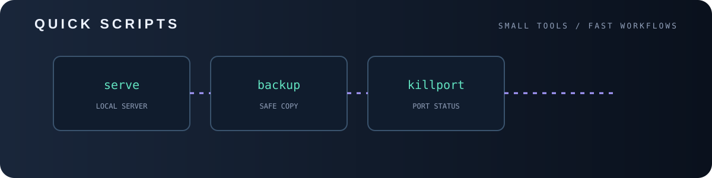

<p align="center">

<p align="center"></p>
  
</p>

# quick-scripts

Five tiny POSIX shell utilities. One file each, no dependencies beyond standard tools.

## Install

```sh
curl -fsSL https://raw.githubusercontent.com/ERROR404DTIR/quick-scripts/main/install.sh | sh
```

Scripts go to `~/.local/bin` (set `PREFIX=/other/dir` to change it). Make sure that folder is in your `PATH`.

## Scripts

| Command | What it does |
|---------|--------------|
| `killport 3000` | kill whatever listens on a TCP port (needs `lsof`) |
| `extract file.tar.gz` | unpack zip, tar, gz, bz2, xz, 7z, rar by extension |
| `backup notes.md` | copy to `notes.md.bak-YYYYMMDD-HHMMSS` |
| `serve [PORT] [DIR]` | static file server on localhost (needs `python3`) |
| `myip` | print your public IP address |

## License

MIT